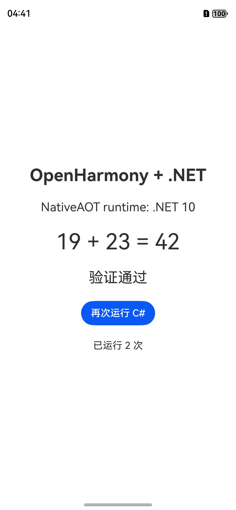

# ISSUE-001 构建与验证记录

验证日期：2026-11-18。工作区已完成迁移，两个架构的 .NET 10 NativeAOT runtime
均从源码构建，生成六个 NuGet 包，并在 x86_64 模拟器运行新示例。

## 环境与输入

| 项目 | 本次使用值 |
| --- | --- |
| 主机 | Windows x64，Visual Studio 2026 C++ 工具链 |
| 主解决方案 SDK | .NET SDK 10.0.301 |
| runtime 构建 SDK | .NET SDK 10.0.109，遵循其 global.json |
| PowerShell | 7.6 |
| runtime 源码 | `dotnet/runtime`，`ce6f99dbe71116623b09e65e4618c2990912cae0` |
| runtime 配置 | Release，API13，x64 / arm64；两份 provenance 均为 `sourceDirty=false` |
| API13 Native SDK | 官方 `5.0.1.111`，下载到 `artifacts/native/sdk/13/native` |
| API15 Native SDK | 官方 `5.0.3.135`，来自 `F:\.huawei\Sdk\15` |
| 本地依赖 | 源码构建 ICU 78.3、OpenSSL 3.5.7，两个 ABI |
| Stage 工具链 | `F:\.huawei\command-line-tools`，内置 API26 SDK `26.0.0.105` |
| Java | `D:\Program Files\Huawei\DevEco Studio\jbr` |
| 模拟器 | Huawei_Phone，x86_64，API17，HDC `127.0.0.1:5555` |

源码、依赖归档和 SDK 使用上游清单校验。运行时编译日志分别为
`artifacts/native/runtime-x64.log` 和 `artifacts/native/runtime-arm64.log`，
两次构建均以 0 warning / 0 error 完成。四个 .NET 子模块提交未变。

## 构建、测试与包验证

从仓库根目录执行（原生依赖准备要求 PowerShell 7.3+）：

```powershell
./build.ps1 -Target Test
./tools/install-native-sdk.ps1
pwsh ./tools/prepare-native-dependencies.ps1 -SdkRoot ./artifacts/native/sdk
pwsh ./tools/build-runtime.ps1 -SdkRoot ./artifacts/native/sdk
./build.ps1 -Target Pack
./tools/verify-packages.ps1 -SdkRoot ./artifacts/native/sdk
./tools/run-abi-matrix.ps1 -SdkRoot F:\.huawei\Sdk -Apis 15
```

| 验证 | 结果 | 本机记录 |
| --- | --- | --- |
| 统一解决方案 | 17 个项目构建成功 | `artifacts/tests-final.log` |
| 单元测试 | 45 通过，0 失败，0 跳过 | 同上及 `artifacts/test-results/*.trx` |
| API15 原生 ABI probe | arm64-v8a、x86_64 均编译通过 | `artifacts/abi-matrix.log` |
| NuGet 独立消费 | 两个架构均 NativeAOT publish 成功 | `artifacts/package-validation.log` |
| 导出及架构 | 两个 C# 导出均存在；每个架构的 17 个共享库均为正确 ELF 架构 | `artifacts/package-validation/result.json` |

45 个测试来自 Bindings（10）、BindingGenerator（17）、PublishAotCross（10）和
RuntimePackager（8）。`tests/PackageConsumer` 是需要已生成 NuGet 包和 Harmony SDK 的
独立集成工程，由 `verify-packages.ps1` 驱动，不加入日常托管构建。
脚本每次使用新的隔离 NuGet 缓存，防止同版本本地包缓存掩盖修改。

包版本为 `10.0.10-ohos.2-preview.1`，输出在 `artifacts/packages/`：

- `OpenHarmony.NDK.Bindings`
- `OpenHarmony.NET.PublishAotCross`
- `OpenHarmony.NET.HapTooling`
- `OpenHarmony.NET.Player.Sdk`
- `OpenHarmony.NET.Runtime.NativeAot.arm64-v8a`
- `OpenHarmony.NET.Runtime.NativeAot.x86_64`

同目录的 `SHA256SUMS` 记录本次六个 nupkg 的校验和。运行时展开目录
`artifacts/runtime/releases/10.0.10-ohos.2-preview.1/` 包含两个架构的
framework/sdk/native、manifest、SBOM 和源码构建 provenance。

## 模拟器验收

本机已部署 Huawei_Phone 镜像，启动命令为：

```powershell
Start-Process -WindowStyle Hidden `
  -FilePath F:\.huawei\command-line-tools\emulator\Emulator.exe `
  -ArgumentList '-start Huawei_Phone -instancePath F:\.huawei\Emulator\deployed -imageRoot F:\.huawei\Sdk -noWindow'

./tools/build-sample.ps1 -SdkRoot ./artifacts/native/sdk `
  -CommandLineTools F:\.huawei\command-line-tools `
  -JavaHome 'D:\Program Files\Huawei\DevEco Studio\jbr'
./tools/sign-sample.ps1 -CommandLineTools F:\.huawei\command-line-tools `
  -JavaHome 'D:\Program Files\Huawei\DevEco Studio\jbr'
./tools/verify-sample.ps1 -CommandLineTools F:\.huawei\command-line-tools
```

应用 `org.openharmony.dotnet.smoke` 通过 ArkTS → N-API → C# NativeAOT 调用链运行。
C# 执行集合分配、LINQ 求和和 GC，返回求和结果和 `Environment.Version.Major`。
启动后的进程日志为：

```text
DOTNET_SMOKE result=42 runtime=10 runs=1
```

点击“再次运行 C#”后，同一进程输出：

```text
DOTNET_SMOKE result=42 runtime=10 runs=2
```



HAP 已通过官方 `hap-sign-tool verify-app` 校验、HDC 安装及启动验证。
签名使用 SDK 自带的公开开发身份，生成仅绑定本机模拟器、有效期 30 天的 profile；
私钥副本与 profile 均留在被忽略的 `artifacts/sample/signing/`。

本机可交付与证据：

- `artifacts/sample/NativeAotSmoke-unsigned.hap`
- `artifacts/sample/NativeAotSmoke-signed.hap`
- `artifacts/sample/evidence/result.json`：设备、API、架构、HAP SHA-256、运行结果
- `artifacts/sample/evidence/install.log`、`hilog.log`、`interaction-hilog.log`
- `artifacts/sample/evidence/screenshot.jpeg`、`screenshot-rerun.jpeg`

## 验证范围

设备运行验收覆盖 API17 / x86_64 模拟器。arm64 已完成源码构建、NuGet 打包、
独立项目交叉编译和 ELF 校验，尚未在 arm64 真机运行；其它 API 未逐一进行设备验收。
本示例未验证网络、TLS、全球化和完整 NDK API 覆盖。

运行时 manifest 延续原打包器的 API13–24、26 alias 兼容映射；其中历史命名的
`verifiedApis` 字段不应视作本次设备测试矩阵。实际测试范围以上述表格及日志为准。
`toolVersions.dotnetRuntime` 记录打包器宿主运行时版本；目标 runtime 源码版本以
`runtimeCommit` 和对应 provenance 为准。

本次解决了迁移后路径引用、工具包打包入口、NuGet 缓存目录分隔符、交叉编译 targets
重复导入，以及无 SONAME 的 NativeAOT 库在 HAP 中被记录为主机绝对路径的问题。
全部产物在本机构建，未上传 NuGet 或执行公开发布。
